# Tutorial: Modeling with patterns

Welcome to the tutorial on modeling with patterns in `torch_structure`. If you have not installed `torch_structure` yet or had problems with the installation process, please refer to the [installation guide](install.md).

TorchStructure's patterns all work in similar ways. First, we will start with a rotational pattern.

---

## A rotational pattern

We start by creating an empty `StructData` graph whose nodes carry 3D coordinates.

```python
import torch
from torch_structure.data.data import StructData
import matplotlib.pyplot as plt

node_attrs = {"coords": torch.empty((0, 3), dtype=torch.float)}
data = StructData(node_attrs=node_attrs)
```

Next, we create a 6-fold rotational pattern and register it on the graph under the name `"rotation"`. By default, it rotates about the z-axis through the origin. Adding a single node (the seed) with `add_nodes_by_pattern` then also adds its five rotated copies.

```python
rotation = data.create_rotational_pattern(6)
data.add_patterns({"rotation": rotation})

data.add_nodes_by_pattern(pattern="rotation", coords=torch.tensor([[1.0, 0.0, 0.0]]))
```

Visualize the result. `plot_pattern` draws the nodes together with the pattern.

```python
data.plot_pattern()
plt.show()
```

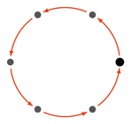{: .ts-fig--light .ts-fig--center }
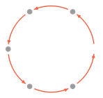{: .ts-fig--dark .ts-fig--center }

Edges work the same way. Adding an edge from the first node to the second with `add_edges_by_pattern` also adds its five rotated copies, which connect the six nodes into a hexagon.

```python
data.add_edges_by_pattern(edge_indices=torch.tensor([[0], [1]]))
```

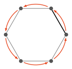{: .ts-fig--light .ts-fig--center }
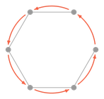{: .ts-fig--dark .ts-fig--center }

The six nodes stay linked through the pattern: if we move one of them, the other five adjust, and the edges follow. Here, we move the first node outwards from (1, 0, 0) to (2, 0, 0) with `set_node_attr_by_pattern`, where `mask` selects the node to move. Edge attributes can be set in a similar manner with `set_edge_attr_by_pattern`, which gives all rotated copies of the selected edge the same value.

```python
mask = torch.tensor([True, False, False, False, False, False])
data.set_node_attr_by_pattern("coords", mask=mask, value=torch.tensor([[2.0, 0.0, 0.0]]))
```

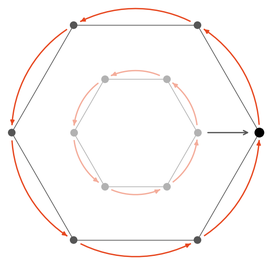{: .ts-fig--light .ts-fig--center }
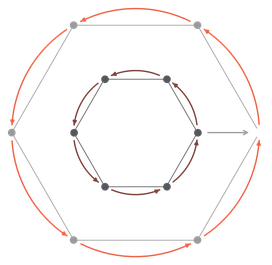{: .ts-fig--dark .ts-fig--center }

To move a single node without its copies, use `set_node_attr` instead of `set_node_attr_by_pattern`. Here, we move the first node slightly inwards, while the other five nodes stay where they are.

```python
data.set_node_attr("coords", mask=mask, value=torch.tensor([[1.6, 0.0, 0.0]]))
```

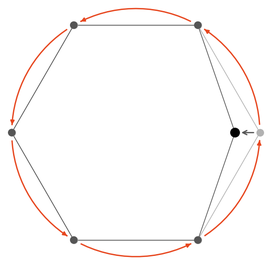{: .ts-fig--light .ts-fig--center }
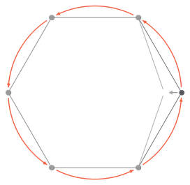{: .ts-fig--dark .ts-fig--center }

---

## A translational pattern

We again start with an empty `StructData` graph whose nodes carry 3D coordinates.

```python
import torch
from torch_structure.data.data import StructData
import matplotlib.pyplot as plt

node_attrs = {"coords": torch.empty((0, 3), dtype=torch.float)}
data = StructData(node_attrs=node_attrs)
```

Next, we create a translational pattern with 4 positions and register it on the graph under the name `"translation"`. By default, each position is shifted by (1, 0, 0) from the previous one. Adding a single node (the seed) with `add_nodes_by_pattern` then also adds its three shifted copies, which gives an array of 4 nodes. We again add an edge from the first node to the second.

```python
translation = data.create_translational_pattern(4)
data.add_patterns({"translation": translation})

data.add_nodes_by_pattern(pattern="translation", coords=torch.tensor([[0.0, 0.0, 0.0]]))
data.add_edges_by_pattern(edge_indices=torch.tensor([[0], [1]]))
```

Visualize the result. `plot_pattern` draws the nodes and edges together with the pattern, each translation step as an arrow.

```python
data.plot_pattern()
plt.show()
```

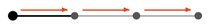{: .ts-fig--light .ts-fig--center }
{: .ts-fig--dark .ts-fig--center }

The nodes stay linked through the pattern. Changing one node changes the others accordingly.

```python
mask = torch.tensor([True, False, False, False])
data.set_node_attr_by_pattern("coords", mask=mask, value=torch.tensor([[0.0, 1.0, 0.0]]))
```

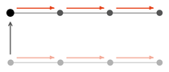{: .ts-fig--light .ts-fig--center }
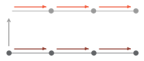{: .ts-fig--dark .ts-fig--center }

---

## Nesting patterns

Patterns can be nested with `nest_patterns`: each pattern copies everything the patterns before it created. Nesting a translation with a rotation can give very different structures, depending on the direction of the translation.

### A polar net

We start with a 4-fold translation along the x-axis nested into a 6-fold rotation to get a polar net of 4 × 6 = 24 nodes. As copies of one seed, they form one expansion (id 0), where each node has a position on every pattern level, innermost pattern first: e.g. `[1, 0]` is one translation step out, `[0, 1]` one rotation step around, and `[3, 2]` 3 translation steps out and 2 rotation steps around. `add_edges_by_pattern_level` connects such positions. An edge from `[0, 0]` to `[1, 0]` runs outwards along the first array.

```python
import torch
from torch_structure.data.data import StructData
import matplotlib.pyplot as plt

node_attrs = {"coords": torch.empty((0, 3), dtype=torch.float)}
data = StructData(node_attrs=node_attrs)

translation = data.create_translational_pattern(4, direction=torch.tensor([1.0, 0.0, 0.0]))
rotation = data.create_rotational_pattern(6)
data.add_patterns({"polar_net": data.nest_patterns([translation, rotation])})

data.add_nodes_by_pattern(pattern="polar_net", coords=torch.tensor([[1.0, 0.0, 0.0]]))
data.add_edges_by_pattern_level(
    src_expansion_ids=[0], dest_expansion_ids=[0],
    src_level_positions=[[0, 0]], dest_level_positions=[[1, 0]],
)
```

Visualize the result.

```python
data.plot_pattern()
plt.show()
```

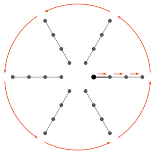{: .ts-fig--light .ts-fig--center }
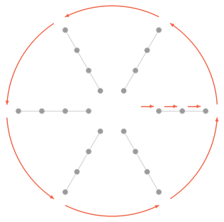{: .ts-fig--dark .ts-fig--center }

We could equally give the edge by the indices of its two nodes, with `add_edges_by_pattern` as in the sections above, or by their positions in the expansion, with `add_edges_per_expansion_by_pattern`. Here, both count the nodes translation by translation, from the inside out, so the level positions `[t, r]` are node and expansion position `t + 4 * r`. In place of the call above, either of these would add the same edges:

```python
data.add_edges_by_pattern(edge_indices=torch.tensor([[0], [1]]))
```

```python
data.add_edges_per_expansion_by_pattern(
    src_expansion_ids=[0], dest_expansion_ids=[0],
    src_expansion_positions=[0], dest_expansion_positions=[1],
)
```

Next, we add an edge in the rotational direction, from level positions `[0, 0]` to `[0, 1]`. Its copies connect nodes in the rotational direction.

```python
data.add_edges_by_pattern_level(
    src_expansion_ids=[0], dest_expansion_ids=[0],
    src_level_positions=[[0, 0]], dest_level_positions=[[0, 1]],
)
```

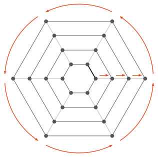{: .ts-fig--light .ts-fig--center }
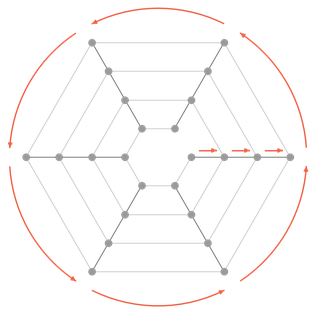{: .ts-fig--dark .ts-fig--center }

Finally, we add an edge in the diagonal direction, from `[0, 0]` to `[1, 1]`.

```python
data.add_edges_by_pattern_level(
    src_expansion_ids=[0], dest_expansion_ids=[0],
    src_level_positions=[[0, 0]], dest_level_positions=[[1, 1]],
)
```

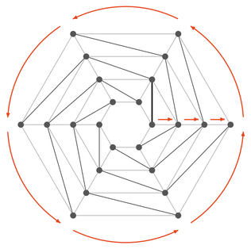{: .ts-fig--light .ts-fig--center }
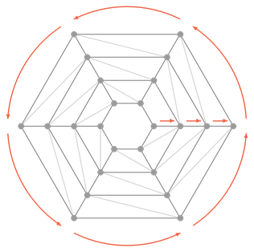{: .ts-fig--dark .ts-fig--center }

Nested patterns stay linked as well. Here, we move the outermost ring outwards, from a radius of 4 to 5, with `set_node_attr_by_pattern_level`, which selects a node by its level positions just like `add_edges_by_pattern_level`: `[3, 0]` is the last node of the first array. `replicate_levels` takes one entry per level of the pattern, innermost first: `[False, True]` freezes the inner pattern (the translation), so the move is copied around the ring but not along the translations. `replicate_levels=[True, True]` would move every ring outwards, and `replicate_levels=[True, False]` would only move one array.

```python
data.set_node_attr_by_pattern_level(
    "coords", expansion_ids=[0], level_positions=[[3, 0]],
    value=torch.tensor([[5.0, 0.0, 0.0]]), replicate_levels=[False, True],
)
```

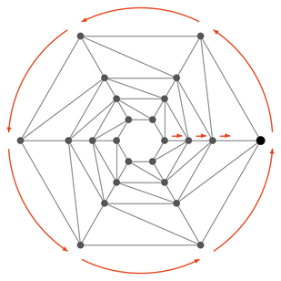{: .ts-fig--light .ts-fig--center }
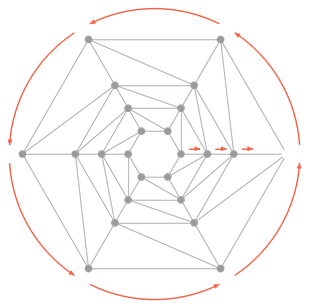{: .ts-fig--dark .ts-fig--center }

### A cylinder

If the translation instead runs along the rotation axis, it stacks the seed into a column of 4 nodes, and the same rotation copies this column into a cylinder of 4 × 6 = 24 nodes. This time, we start with an edge in the rotational direction, from `[0, 0]` to `[0, 1]`. Its copies connect the nodes at each height into a closed ring, which gives 4 × 6 = 24 edges.

```python
import torch
from torch_structure.data.data import StructData
import matplotlib.pyplot as plt

node_attrs = {"coords": torch.empty((0, 3), dtype=torch.float)}
data = StructData(node_attrs=node_attrs)

translation = data.create_translational_pattern(4, direction=torch.tensor([0.0, 0.0, 1.0]))
rotation = data.create_rotational_pattern(6)
data.add_patterns({"cylinder": data.nest_patterns([translation, rotation])})

data.add_nodes_by_pattern(pattern="cylinder", coords=torch.tensor([[1.0, 0.0, 0.0]]))
data.add_edges_by_pattern_level(
    src_expansion_ids=[0], dest_expansion_ids=[0],
    src_level_positions=[[0, 0]], dest_level_positions=[[0, 1]],
)
```

Visualize the result.

```python
data.plot_pattern()
plt.show()
```

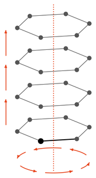{: .ts-fig--light .ts-fig--center }
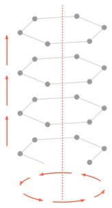{: .ts-fig--dark .ts-fig--center }

Again, we could equally give this edge by node index or by expansion position. Both now count the nodes column by column, from the bottom up, so `[0, 1]` is node and expansion position 4. In place of the call above, either of these would add the same 24 edges:

```python
data.add_edges_by_pattern(edge_indices=torch.tensor([[0], [4]]))
```

```python
data.add_edges_per_expansion_by_pattern(
    src_expansion_ids=[0], dest_expansion_ids=[0],
    src_expansion_positions=[0], dest_expansion_positions=[4],
)
```

Next, we add an edge in the translational direction, from `[0, 0]` to `[1, 0]`, one step up the first column. Its copies connect the nodes of every column.

```python
data.add_edges_by_pattern_level(
    src_expansion_ids=[0], dest_expansion_ids=[0],
    src_level_positions=[[0, 0]], dest_level_positions=[[1, 0]],
)
```

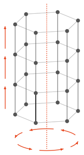{: .ts-fig--light .ts-fig--center }
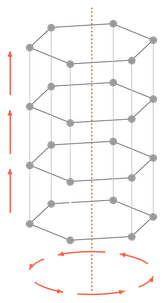{: .ts-fig--dark .ts-fig--center }

Finally, we add an edge in the diagonal direction, from `[0, 0]` to `[1, 1]`.

```python
data.add_edges_by_pattern_level(
    src_expansion_ids=[0], dest_expansion_ids=[0],
    src_level_positions=[[0, 0]], dest_level_positions=[[1, 1]],
)
```

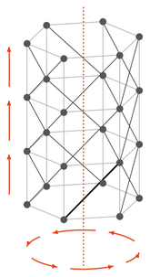{: .ts-fig--light .ts-fig--center }
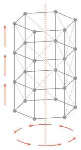{: .ts-fig--dark .ts-fig--center }

`set_node_attr_by_pattern_level` with `replicate_levels=[False, True]` again replicates the changed value of a node around the ring, but not up the columns.

```python
data.set_node_attr_by_pattern_level(
    "coords", expansion_ids=[0], level_positions=[[1, 0]],
    value=torch.tensor([[1.2, 0.0, 1.0]]), replicate_levels=[False, True],
)
```

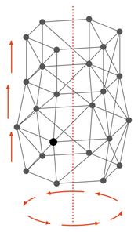{: .ts-fig--light .ts-fig--center }
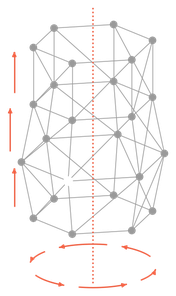{: .ts-fig--dark .ts-fig--center }
