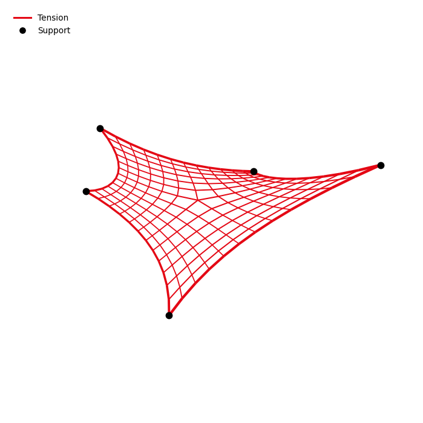
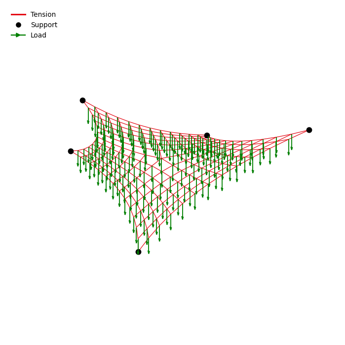
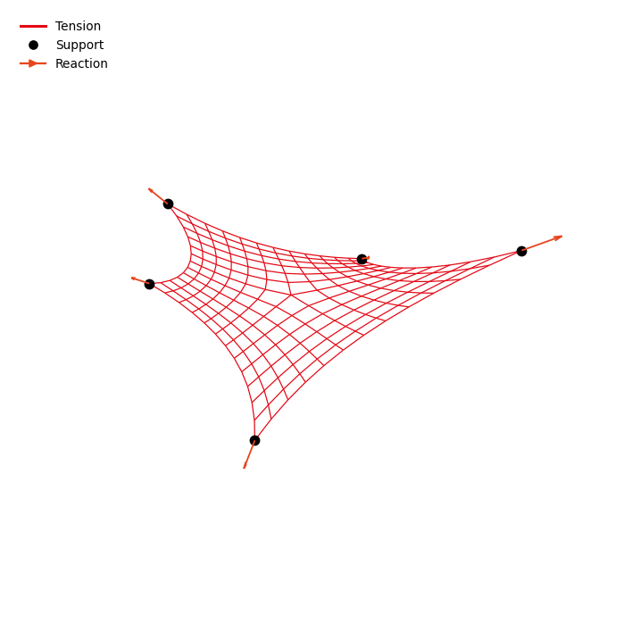
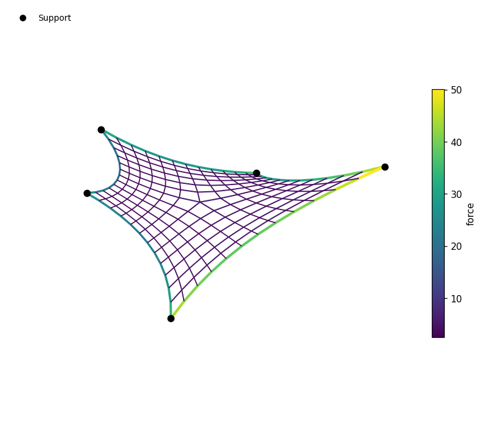
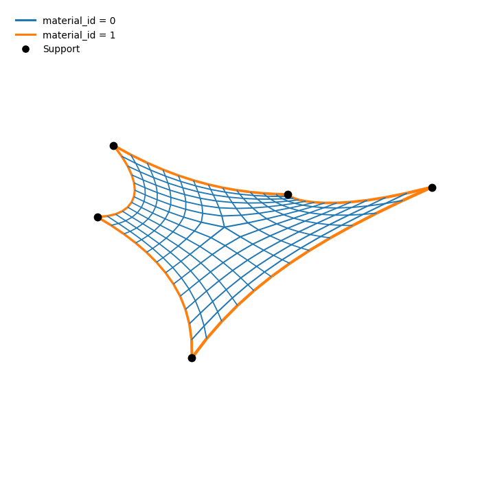
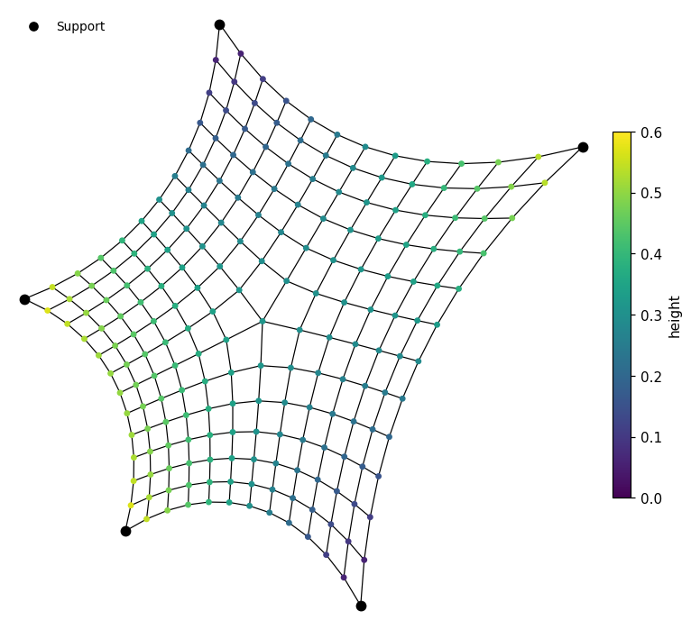
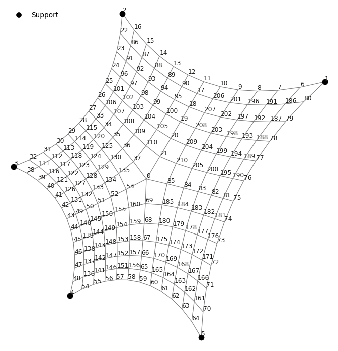
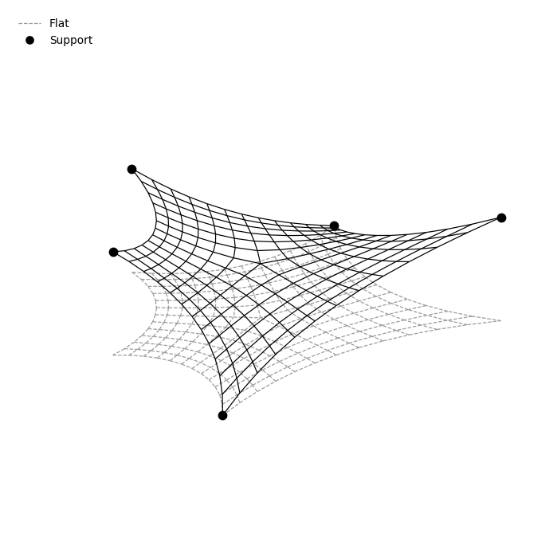

# Plotting structures

Every `StructData` object can draw itself with `data.plot()`. The same function is available as
[`plot_structure`][torch_structure.plot.structure.plot_structure] in `torch_structure.plot`, so
`data.plot(...)` and `plot_structure(data, ...)` are interchangeable.

This page explains what is drawn by default, and how to color, size and label edges and nodes by
any of their attributes.

---

## The default plot

```python
data.plot(show=True)
```



Without any arguments, `plot` draws what the structure in a way you might be used to seeing it:

- **Edges**: every undirected edge is drawn once. If the structure has a `force` attribute, edges in
  tension are red, edges in compression blue and edges without force gray, and the line width grows
  with the magnitude of the force.
- **Supports**: nodes with `is_support` are drawn as black circles, or as squares when they also
  restrain rotations (`support_rxyz`).
- **Nodes** are not drawn by default, see [Nodes](#nodes).

The legend lists everything that was drawn. `plot` returns the matplotlib axis, so you can keep
adding to the figure, and the `show=True` argument displays it. To save the figure, pass a
path: `data.plot(path="cable_net")` writes `cable_net.png`.

---

## Loads and reactions

`loads=True` draws the `load` attribute as green arrows starting at their nodes:

```python
data.plot(loads=True, vector_scale=1.5, edge_width=0.8)
```



`reactions=True` draws the `reaction_force` attribute as orange arrows.

```python
data.plot(reactions=True, vector_scale=0.0025, edge_width=0.8)
```



Both also take another attribute name or a tensor of shape `[num_nodes, 3]`. Any other node
vectors are drawn with `vectors`, a dictionary from legend label to attribute name or tensor:

```python
data.plot(vectors={"Residual": residual_force})
```

The length of an arrow shows the magnitude of its force: all arrows in a plot share one scale, by
default chosen so that the longest arrow is 15 % of the structure's size. `vector_scale` sets the
arrow length per unit of force instead.

---

## Coloring by an attribute

`edge_color` and `node_color` take the name of an attribute. How its values are turned into colors
depends on their type.

**Floating-point numbers** get a colormap and a colorbar, as do integers with more than 10 different
values:

```python
data.plot(edge_color="force")
```



When the values have both signs, the colormap is diverging and centred on zero. Use `cmap` to choose another colormap and `clim=(low, high)` to fix its range.

**Integers with at most 10 different values** are treated as categories, each with its own color and
legend entry. This suits ids such as a `material_id`:

```python
data.plot(edge_color="material_id")
```



**Booleans** highlight the `True` entries, e.g. `edge_color="is_boundary_edge"`.

**A plain color** draws everything in that color: `edge_color="black"`.

Instead of an attribute name, you can also pass the values directly as a tensor. This is handy for
quantities that are not stored on the graph:

```python
data.plot(edge_color=data.length_from_coords)
```

!!! note "Directed and undirected edges"
    `StructData` stores every edge in both directions. Edge values can be given for all directed
    edges, as stored, or for every undirected edge once, e.g.
    `data.force[data.directed_mask.view(-1)]`. `plot` recognizes both by their length.

---

## Line widths

`edge_width` works like `edge_color`: an attribute name or values, whose magnitude sets the width,
or a constant width.

```python
data.plot(edge_width="force_density")   # wider edges for larger force densities
data.plot(edge_width=1.0)               # every edge equally thin
```

`lw_scale` sets the global line width scale for all edges.

---

## Views

`view` selects a 3D view or a 2D projection:

| `view` | shows |
| --- | --- |
| `"3d"` (default) | an axonometric 3D view |
| `"xy"` | the plan |
| `"xz"` | the elevation along x |
| `"yz"` | the elevation along y |

Projections are often easier to read for planar structures such as trusses and arches. All axes share
one scale unless `equal_axes=False`, and `show_axes=True` adds axis lines and labels.

---

## Nodes

Nodes are drawn as soon as you give them a color or size. Both take the same kinds of values as the
edges:

```python
data.height = data.coords[:, 2:]
data.plot(view="xy", edge_color="black", edge_width=0.8, node_color="height")
```



`node_size` takes a constant marker size, or an attribute whose magnitude sets the size.

---

## Labels

`node_labels` writes text at each node and `edge_labels` at each edge's midpoint:

- `"index"`: the node index, or the edge's row in `edge_index`;
- `"name"` (nodes only): the node names given in `add_node`;
- an attribute name or values, formatted with `label_format` (default `"{:.3g}"`); attributes with
  several components, such as `"coords"`, are written as tuples;
- a list of strings, one per node or edge, where empty strings are left out.

```python
data.plot(view="xy", edge_color="grey", edge_width=0.8, node_labels="index")
```



---

## Comparing with a reference geometry

`ghost` draws a second geometry, dashed and gray, behind the structure. It takes other coordinates
for the same structure, such as the geometry before form finding or a target shape, or a different
`StructData` object.

```python
data.plot(ghost=initial_coords, ghost_label="Initial geometry", edge_color="black", edge_width=0.8)
```



To plot the structure itself at other coordinates, pass them as `coords`, e.g.
`data.plot(coords=result.coords, ghost=data.coords, ghost_label="Undeformed")`.

---

## Showing part of a structure

`edge_mask` and `node_mask` select what is drawn, as a boolean mask or a list of indices:

```python
data.plot(edge_mask=data.force.view(-1) > 0)        # only the edges in tension
data.plot(node_mask=[0, 5, 12], node_labels="index")  # label three nodes
```

`node_mask` applies to the nodes, their labels, supports and arrows; the edges are drawn regardless.

---

## Combining plots

Because `plot` returns its axis and accepts one with `ax`, several plots can be drawn into one
figure. Plots on the same axis are overlaid, and the legend keeps the entries of each:

```python
ax = before.plot(edge_color="grey")
after.plot(ax=ax, title="Before and after")
```

For side-by-side plots, create the axes yourself. Use a 3D axis for the 3D view and a 2D axis for
projections:

```python
fig = plt.figure(figsize=(12, 5))
data.plot(ax=fig.add_subplot(121, projection="3d"))
data.plot(ax=fig.add_subplot(122), view="xz")
```

---

The [API reference][torch_structure.plot.structure.plot_structure] describes every argument in full.
